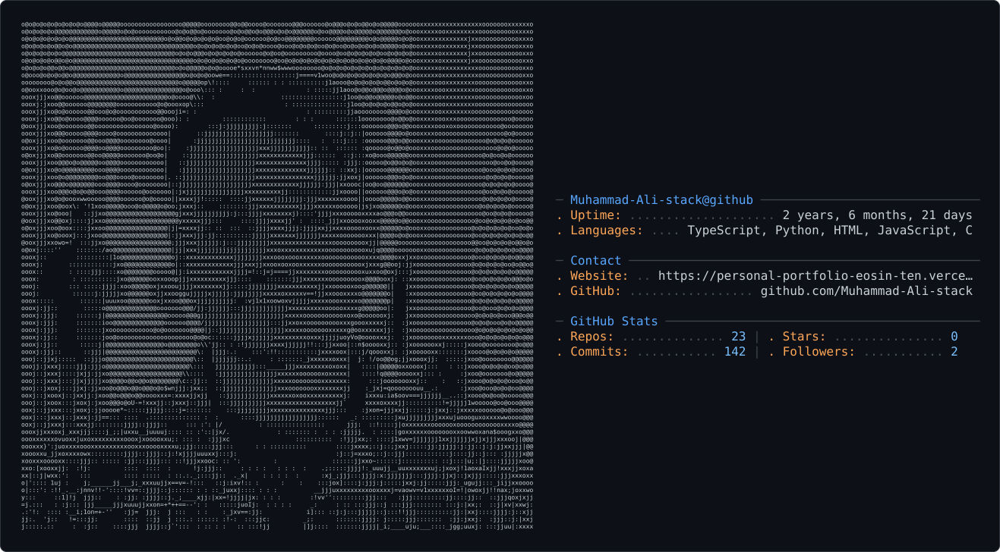

<div align="center">

<picture>
  <source media="(prefers-color-scheme: dark)" srcset="dark_mode.svg" />
  <source media="(prefers-color-scheme: light)" srcset="light_mode.svg" />
  
</picture>


<br/>

[](https://www.linkedin.com/in/muhammad-ali-50159b2b1/)
[](https://personal-portfolio-eosin-ten.vercel.app/)
[](mailto:muhammadbvs2021@gmail.com)
[](https://github.com/Muhammad-Ali-stack)
[](https://leetcode.com/Muhammad_Ali2023/)

</div>

---

## `whoami`

```typescript
const dev = {
  role        : "Agentic Engineer | App & Web Developer | SaaS Builder | LLM/AI Developer",
  agentStack  : ["Claude Code", "OpenAI Codex", "AI Agents", "MCP Servers", "Multi-Agent Workflows"],
  experience  : "3.5+ years in production (CloudJunction Advisors, NED University)",
  focus       : ["Cross-Platform Apps (Flutter, React Native, Expo, Swift)", "Full-Stack Web & SaaS", "LLM/AI Systems", "Backend & Fintech APIs"],
  currently   : "Building mobile apps, SaaS platforms, and LLM-powered products end to end",
  education   : "B.S. Computer Science @ NED University (Expected April 2027)",
  achievements: [
    "Shipped PaperDesk to 15,500+ real users (ICONICS Conference Management Portal)",
    "8,000+ combined downloads across published Play Store apps",
    "2nd & 3rd place, competitive programming (FAST WebHunt)",
    "IELTS Band 7 (C1 English)",
    "Microsoft Azure Fundamentals (AZ-900)",
  ],
  superpower  : "Shipping apps and backends where every transaction is safe, every ledger balances, and every API survives at scale",
};
```

---

## Agentic Engineering

<div align="center">

[](https://claude.com/claude-code)
[](https://openai.com/codex)
[](#agentic-engineering)
[](https://modelcontextprotocol.io)
[](https://www.langchain.com)
[](https://github.com/features/copilot)

</div>

> **Currently building:** Claude Code skills and multi-agent pipelines, like the [LinkedIn Agent](https://github.com/Muhammad-Ali-stack/Claude-Code-Linkedin-Agent) (15 skills) and a [DevOps Agent](https://github.com/Muhammad-Ali-stack/DevOps-Agent) that watches logs, diagnoses root causes, and drafts fixes.

```
I'm an Agentic Engineer.
I don't just write code. I design, orchestrate, and ship with AI agents.
Claude Code and Codex are my pair programmers.
MCP servers connect my agents to real tools and real data.
Multi-agent workflows plan, build, review, and test in parallel.
```

I build **AI agents into products**, and I build products **with AI agents**. My daily workflow runs on Claude Code and OpenAI Codex for planning, implementation, code review, and refactoring, while the products I ship use agents that reason over live data and take real actions.

**Agentic products I've built:**

| Product | What the agent does | Stack |
|---|---|---|
| **[Claude Code LinkedIn Agent](https://github.com/Muhammad-Ali-stack/Claude-Code-Linkedin-Agent)** | 15 Claude Code skills that run LinkedIn end to end: profile scoring, posts, comments, DMs, job search. Includes a humanizer, and nothing is posted without approval | Claude Code · Agent Skills |
| **[DevOps Agent](https://github.com/Muhammad-Ali-stack/DevOps-Agent)** | Multi-agent pipeline that watches logs, diagnoses root causes, and drafts fixes automatically | Multi-Agent · LLMs |
| **[MCP Server](https://github.com/Muhammad-Ali-stack/MCP-Server)** | Custom MCP server exposing tools over JSON-RPC to Gemini and Copilot clients | MCP · JSON-RPC |
| **[CRM-Mind](https://github.com/Muhammad-Ali-stack/CRM-Mind)** | Natural-language agent that queries, creates, updates, and summarizes Salesforce records | Groq · Gemini · Salesforce OAuth |
| **[MicroNeuro](https://github.com/Muhammad-Ali-stack/MicroNeuro)** | Outlook agent that reads the inbox via Microsoft Graph, extracts meetings and action items, and creates events or sends emails from prompts | Groq (Llama 3.3) · MS Graph |
| **[Dhoom](https://github.com/Muhammad-Ali-stack/Dhoom-Your-Local-AI-Agent)** | AI UI-engineering agent that generates, previews, edits, and exports production React components. [Live demo](https://dhoom-your-local-ai-agent.vercel.app) | React · Multi-provider LLMs |
| **[AlphaSignal](https://github.com/Muhammad-Ali-stack/AlphaSignal)** | AI research agent over SEC EDGAR earnings calls: RAG retrieval, sentiment, and UP/DOWN/NEUTRAL signals with reasoning | Python · RAG · Vector DBs |
| **Stratum-AI** | AI assistant layer across Salesforce, HubSpot, and ServiceNow that routes queries to the right system | React · TypeScript · Supabase |

**Agent skills:**

```
Tool / function calling       MCP server development       Subagent orchestration
RAG & vector retrieval        Evals & guardrails           Prompt engineering & caching
Human-in-the-loop approvals   Claude Code skills & hooks   Multi-provider LLM routing
```

**How I use agents:**

```
I write the spec  →  agents draft  →  I review every diff  →  tests + evals gate it  →  ship
```

Agents make me faster. They don't make the decisions. I own the architecture, read every line before it merges, and keep a human in the loop for any agent that takes real-world actions.

```
┌──────────────────────────────────────────────────────────────┐
│                    My Agentic Workflow                       │
├──────────────┬──────────────┬──────────────┬─────────────────┤
│   Plan       │   Build      │   Review     │   Ship          │
│  Claude Code │  Claude Code │  AI Code     │  Agents in      │
│  plan mode   │  + Codex     │  Review      │  production     │
│  Specs/Tasks │  Subagents   │  Tests/Evals │  MCP + Tools    │
└──────────────┴──────────────┴──────────────┴─────────────────┘
```

---

## What I Do

```
One idea. One codebase philosophy. Every platform.
Flutter and React Native for mobile.
Expo for fast iteration and OTA updates.
Swift for native iOS when it matters.
A full web/SaaS stack behind all of it.
LLMs woven in wherever they add real value.

That's the range I build in.
```

I ship across the whole surface: mobile apps (Flutter, React Native, Expo, native Swift), full-stack web and SaaS products, and LLM/AI-powered features baked into real products, not bolted on. 3.5+ years of production experience taught me how to take a product from idea to app store to paying users, with AI as a first-class part of the stack, not an afterthought.

---

## What I've Shipped

> Real production systems. Real users. Real accountability.

| Project | What it does | Scale | Stack |
|---|---|---|---|
| **PaperDesk** | Conference management platform: submissions, review, scheduling, admin workflows | **15,500+ users**, [paperdesk.neduet.edu.pk](https://paperdesk.neduet.edu.pk) | React · Express · Supabase |
| **AlphaSignal** | AI financial intelligence platform, analyzes SEC EDGAR earnings calls with RAG, vector search & LLM sentiment extraction | Production | Python · RAG · Vector DBs · LLMs |
| **Clearledger-BE** | Double-entry ledger backend with idempotent transactions, reconciliation engine, and audit trail | Fintech-grade | Node.js · TypeScript · PostgreSQL |
| **Stratum-AI** | Full-stack CRM assistant integrating Salesforce, HubSpot, ServiceNow with AI-driven query layer | Enterprise | React · TypeScript · Express · Supabase |
| **CRM-Mind** | Natural language Salesforce interface: create, update, query records via LLM | Enterprise | Node.js · TypeScript · Groq · LangChain |
| **Ambition & NEDIAN** | Role-based mobile apps published on Google Play | 8,000+ combined downloads | React Native · Kotlin · Firebase |
| **AI Data (RAG) Service** | Access-scoped CRM data retrieval exposed to enterprise LLMs, rate limiting, context chunking | Enterprise-grade | Node.js · LangChain · Vector DBs |

---

## What I Build Across

```
┌─────────────────────────────────────────────────────────────────────┐
│                       Systems I Build                               │
├──────────────────┬───────────────────┬──────────────────────────────┤
│  Cross-Platform  │  Web & SaaS       │   LLM & AI Systems           │
│  Apps            │                   │                              │
│  Flutter         │  Full-Stack Web   │  RAG Pipelines               │
│  React Native    │  SaaS Backends    │  Vector-Based Retrieval      │
│  Expo            │  Payment Systems  │  LLM-Powered Features        │
│  Swift (iOS)     │  Auth & APIs      │  AI Agents & MCP             │
│  Play + App Store│  Multi-Tenant     │  Sentiment/Data Extraction   │
└──────────────────┴───────────────────┴──────────────────────────────┘
```

---

## Tech Stack

<div align="center">

**App Development (Mobile & Cross-Platform)**


**Web & SaaS**


**Agentic Coding & AI Agents**


**LLM & AI Development**


**Enterprise Integrations**


**Cloud, Data & DevOps**


</div>

---

## By The Numbers

<div align="center">

| | | | |
|:---:|:---:|:---:|:---:|
| **3.5+** | **15,500+** | **3** | **2** |
| Years in Production | Real Users Served (PaperDesk) | Mobile Apps Shipped | SaaS Platforms |
| | | | |
| **Top 3** | **Band 7** | **AZ-900** | **$0 → Live** |
| Competitive Programming | IELTS English | Azure Certified | Products Built from Scratch |

</div>

---

## GitHub Activity

<div align="center">
  
  
</div>

---

## How I Work

```
Problem  →  System Design  →  Clean Architecture  →  Ship  →  Measure  →  Iterate
```

I think in platforms and failure modes before I write a line of code. Same product logic, shipped natively on iOS with Swift, cross-platform with Flutter or React Native and Expo, and as a full web/SaaS product, with LLMs wired in wherever they genuinely improve the product. Every API I design is idempotent by default. Every transaction is atomic or it rolls back. Every feature is built to ship to real users, not just demo well.

That's not caution. That's craft.

---

<div align="center">

**Agentic engineer building apps, web platforms, and AI agents across every stack. Let's talk.**

[](mailto:muhammadbvs2021@gmail.com)

<sub>3.5+ years in. shipped to 15,500+ real users. still hungry.</sub>

</div>

---
